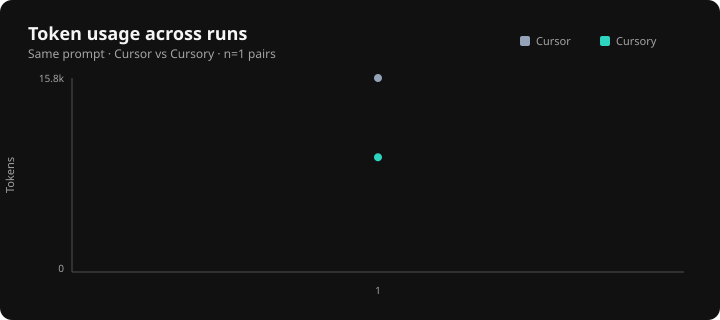
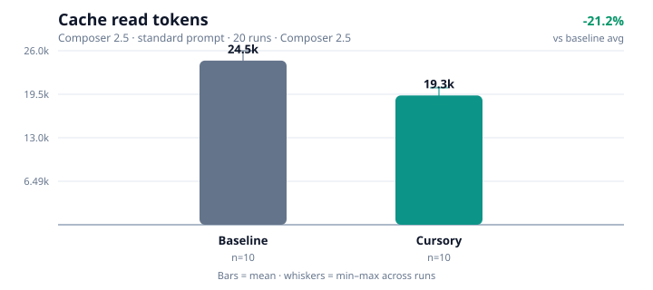

# Cursory

**Local-first Cursor plugin that cuts unnecessary LLM context — without guessing, summarizing, or throwing away the raw answer.**

Send the minimum context needed to solve the task. Keep a progressive path back to the exact file, log, or diff when the model needs more.

[](LICENSE)
[](package.json)
[](package.json)
[](#benchmarks)

---

## Benchmarks

Charts come from repeated **Cursor Agent** A/B runs (same prompt, same model, isolated git worktrees) — not GUI automation.

```bash
pnpm build && pnpm install:local
pnpm cursory benchmark fix-session-redirect --runs 3
pnpm bench:charts
```

```text
baseline:  CURSORY_ENABLED=0  agent -p "..." --output-format stream-json
cursory:   CURSORY_ENABLED=1  agent -p "..." --output-format stream-json
```

See [docs/AGENT-BENCHMARK.md](docs/AGENT-BENCHMARK.md).

### Token usage


### Response time



### Cache usage



```bash
pnpm cursory benchmark --list
pnpm cursory benchmark --dry-run --runs 2    # no agent binary required
pnpm bench:charts
```

Offline fixture estimates (`pnpm benchmark`) still validate progressive disclosure + 100% raw recoverability. Live charts prefer Agent CLI metrics (or dashboard captures via `pnpm bench:record`).

---

## Why it works

Most agent waste is deterministic: full trees, repeated files, noisy test logs, huge diffs, irrelevant docs. Cursory attacks that first — ignore rules, hashing/dedupe, Git-aware ranking, exact search, and bounded progressive output — then exposes smaller MCP tools the agent can prefer over dumping everything into the chat.

```text
Native Read / Grep / Shell  ──preToolUse──►  silently capped inputs
Agent needs ranked / symbol / verbose work  ──MCP──►  smart_* tools
Bounded output still insufficient           ──MCP──►  get_raw / force_full
```

Hooks never append steering messages or duplicate context into the conversation. Savings come from **smaller host operations**, not from rewriting history.

## What it does

- Caps large native **Read / Grep / Shell** inputs via `preToolUse` `updated_input`
- Serves ranked search, symbol/range reads, and reduced command/diff/log output over MCP
- Dedupes session content with SHA-256 hashing and range/symbol cache hits
- Keeps raw recoverability (`cursory_get_raw`, `force_full`) so compression is never one-way
- Stays local: no cloud backend, no default telemetry, no Cursor auth token required

## What it does **not** do

- Blindly summarize or rewrite your source with an LLM
- Patch Cursor binaries or intercept model traffic
- Claim exact dollar savings without measurable billing data
- Permanently discard command/file output
- Block ordinary small reads or shell commands

---

## Install (development)

**Requirements:** Node.js 20+, pnpm 9+ (repo uses pnpm 10), Cursor with local plugin imports.

```bash
pnpm install
pnpm typecheck
pnpm test
pnpm build
pnpm install:local
```

Then in Cursor: **Developer: Reload Window** → **Customize** → confirm plugin **cursory**.

| OS | Install path |
| --- | --- |
| Windows | `%USERPROFILE%\.cursor\plugins\local\cursory` |
| macOS / Linux | `~/.cursor/plugins/local\cursory` |

## Default tools

| Tool | When the agent should use it |
| --- | --- |
| `cursory_smart_search` | Broad or noisy repository searches |
| `cursory_smart_read` | Large, repeated, symbol, or range reads |
| `cursory_smart_run` | Verbose tests, builds, logs, and diffs |
| `cursory_get_raw` | Exact recovery when bounded output is not enough |

Small targeted operations stay on native Cursor tools. The smaller MCP surface reduces idle schema overhead and makes routing clearer.

## Configuration

Copy [`cursory.config.example.json`](cursory.config.example.json) to `cursory.config.json`.

Default mode: `balanced`. Modes never disable raw expansion.

Editor settings (sidebar, optimization mode, budgets) are also available under **Cursory: Open Settings**.

## Reproduce the numbers

```bash
pnpm cursory benchmark fix-session-redirect --runs 3
pnpm bench:charts
pnpm benchmark          # offline fixture suite
pnpm test
```

Live Cursor cannot replace the host conversation from a plugin. Offline scenarios may use replacement semantics for measurement; in live Cursor savings come from choosing a bounded Cursory path instead of a raw dump.

## Privacy

- Local-first; no analytics server by default
- No code uploads / external APIs in the default path
- Session metrics stay under the OS data directory:
  - Windows: `%LOCALAPPDATA%\cursory`
  - macOS: `~/Library/Application Support/cursory`
  - Linux: `~/.local/share/cursory` (or `$XDG_DATA_HOME/cursory`)
  - Override: `CURSORY_DATA_DIR`
- Raw terminal spill is temporary (TTL)

## Limitations

- Active AST engine is the TypeScript compiler API (portable)
- Tree-sitter adapter is optional until grammars are wired
- Vue / PHP / Python still use regex fallback
- Fixture benchmarks are synthetic/local — pair with live agent evals before claiming production savings

## Docs

| Doc | Contents |
| --- | --- |
| [docs/ARCHITECTURE.md](docs/ARCHITECTURE.md) | System shape and optimization priority |
| [docs/CURSOR-INTEGRATION.md](docs/CURSOR-INTEGRATION.md) | Install, hooks, MCP, troubleshooting |
| [docs/cursor-api.md](docs/cursor-api.md) | Documented Cursor surfaces only |
| [docs/AGENT-BENCHMARK.md](docs/AGENT-BENCHMARK.md) | Cursor Agent A/B runner |
| [eval/SCORECARD.md](eval/SCORECARD.md) | Manual live scorecard |

## License

[MIT](LICENSE)
