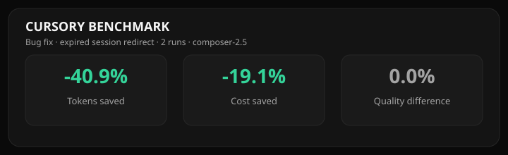
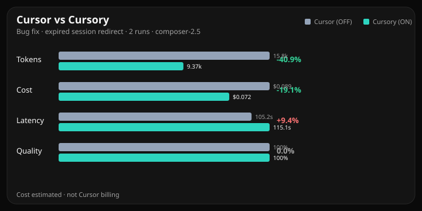
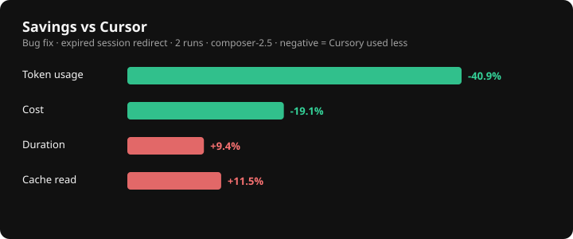
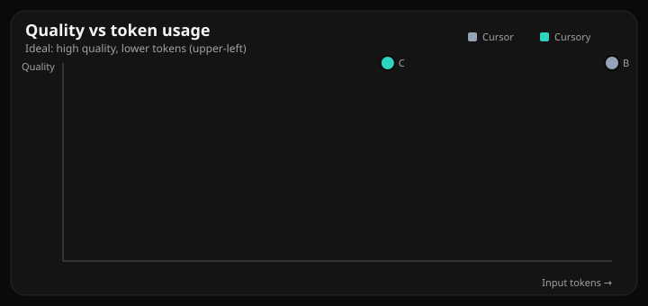
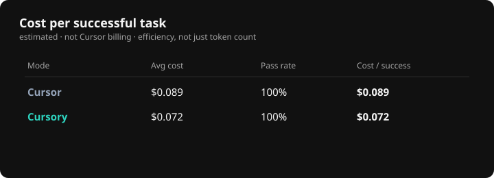
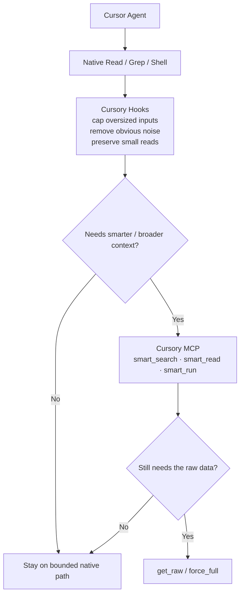

<p align="center">
  
</p>

<p align="center">
  <strong>Local-first context optimization for Cursor.</strong><br>
  Send less unnecessary context to the model while keeping an exact path back to the original file, log, diff, or command output.
</p>

<p align="center">
  <a href="#benchmarks">Benchmarks</a> ·
  <a href="#how-it-works">How it works</a> ·
  <a href="#features">Features</a> ·
  <a href="#installation">Installation</a> ·
  <a href="#configuration">Configuration</a>
</p>

<p align="center">
  <a href="LICENSE">
    
  </a>
  <a href="package.json">
    
  </a>
  <a href="package.json">
    
  </a>
  <a href="#benchmarks">
    
  </a>
</p>

---

## What is Cursory?

Cursory is a **local-first Cursor plugin for reducing unnecessary LLM context usage**.

Instead of feeding the model entire files, repository trees, huge diffs, repeated content, or thousands of lines of test output, Cursory tries to provide the **smallest useful amount of context first**.

If the model needs more, it can progressively expand back to the exact original content.

Cursory does **not** depend on lossy LLM summarization to achieve this. The original data remains recoverable.

> **Less context when possible. Exact context when necessary.**

---

## Benchmarks

Benchmarks use real **Cursor Agent A/B runs** with:

- the same task
- the same model
- isolated Git worktrees
- repeatable verification
- multiple runs per configuration

Run a benchmark yourself:

```bash
pnpm cursory benchmark fix-session-redirect --runs 10
pnpm bench:charts
```

Benchmark data is stored under [`benchmarks/runs/`](benchmarks/runs/).

### Headline results



### Cursor vs Cursory



### Token savings



### Quality vs token usage



### Tokens across runs


### Cost per successful task



> Cost charts use transparent token-rate estimates for comparison. They do **not** represent Cursor invoice or subscription billing.

Quality is based on task verification / expected outcome rather than subjective model grading.

See [`docs/AGENT-BENCHMARK.md`](docs/AGENT-BENCHMARK.md) for the benchmark methodology.

---

## How it works

A lot of agent context waste is predictable:

- entire files when only one function matters
- repeated reads of unchanged content
- massive repository searches
- noisy test and build output
- large Git diffs
- generated files
- irrelevant documentation
- duplicated context across a session

Cursory reduces that waste before reaching for more aggressive compression techniques.



Native operations stay native when they are already small.

Large or noisy operations can be bounded through Cursor hooks or routed through Cursory's MCP tools.

If bounded output is insufficient, the agent can recover the full original result.

### Optimization strategy

Cursory prioritizes deterministic reductions:

1. ignore irrelevant paths
2. avoid duplicate context
3. rank relevant search results
4. target symbols and ranges
5. bound verbose output
6. progressively expand only when required

This keeps optimization predictable and debuggable.

---

## Features

### Context-aware file reads

`cursory_smart_read` can return only the relevant:

- symbol
- line range
- surrounding context
- changed section
- requested portion of a large file

without making the original file inaccessible.

### Ranked repository search

`cursory_smart_search` reduces broad search noise using repository-aware ranking and configurable limits.

### Bounded command output

`cursory_smart_run` is designed for noisy commands such as:

```text
tests
builds
linters
Git diffs
logs
type checking
large shell commands
```

Useful output is returned first while the full result can remain recoverable.

### Session deduplication

Cursory uses SHA-256 hashing to detect content already seen during the session.

Repeated identical content does not need to be treated as brand-new context every time.

### Git-aware context

Repository state can help prioritize:

- modified files
- relevant diffs
- recently touched code
- task-related paths

### Progressive expansion

Compression is not one-way.

If the agent needs more context:

```text
bounded result
      ↓
expanded range
      ↓
larger result
      ↓
exact raw output
```

### Local-first

The default optimization path runs locally.

No external Cursory backend is required.

---

## What Cursory does not do

Cursory does **not**:

- blindly summarize source code with another LLM
- rewrite source before the model sees it
- patch Cursor binaries
- intercept Cursor's model traffic
- require your Cursor authentication token
- permanently discard file or command output
- block normal small reads
- claim exact billing savings without actual billing data

The goal is to optimize **context selection**, not manipulate the conversation history.

---

## Tools

| Tool | Purpose |
| --- | --- |
| `cursory_smart_search` | Ranked and bounded repository search |
| `cursory_smart_read` | Symbol, range, large-file, and repeated reads |
| `cursory_smart_run` | Tests, builds, logs, diffs, and verbose commands |
| `cursory_get_raw` | Recover the exact original output |

Cursory intentionally keeps the MCP surface small.

Small targeted operations should continue using Cursor's native tools.

---

## Installation

### Requirements

- Node.js 20+
- pnpm 9+
- Cursor with local plugin imports enabled

The repository currently uses **pnpm 10**.

### Development install

```bash
pnpm install
pnpm typecheck
pnpm test
pnpm build
pnpm install:local
```

Then reload Cursor:

```text
Developer: Reload Window
```

Open:

```text
Customize
```

and confirm that **Cursory** appears as a local plugin.

### Install locations

| OS | Path |
| --- | --- |
| Windows | `%USERPROFILE%\.cursor\plugins\local\cursory` |
| macOS | `~/.cursor/plugins/local/cursory` |
| Linux | `~/.cursor/plugins/local/cursory` |

---

## Configuration

Copy:

```text
cursory.config.example.json
```

to:

```text
cursory.config.json
```

The default optimization mode is:

```json
{
  "mode": "balanced"
}
```

Available settings include:

- optimization mode
- output budgets
- search limits
- read limits
- command-output limits
- sidebar behavior

Configuration is also available inside Cursor through:

```text
Cursory: Open Settings
```

All modes preserve a path to raw expansion.

---

## Reproduce the benchmarks

Run live Cursor Agent benchmarks:

```bash
pnpm cursory benchmark fix-session-redirect --runs 3
pnpm bench:charts
```

Run the offline fixture benchmark suite:

```bash
pnpm benchmark
```

Run validation:

```bash
pnpm test
pnpm typecheck
```

### Live vs offline benchmarks

A Cursor plugin cannot replace already-recorded host conversation history.

Because of that, offline fixtures may use replacement semantics to measure theoretical reductions.

In real Cursor sessions, savings come from preventing oversized context from entering the conversation in the first place by choosing a bounded Cursory path instead of a full raw dump.

---

## Privacy

Cursory is designed to be local-first.

By default:

- no analytics backend
- no code upload service
- no external optimization API
- no Cursor authentication token access

Session metrics are stored locally.

| OS | Data directory |
| --- | --- |
| Windows | `%LOCALAPPDATA%\cursory` |
| macOS | `~/Library/Application Support/cursory` |
| Linux | `~/.local/share/cursory` or `$XDG_DATA_HOME/cursory` |

Override the location with:

```bash
CURSORY_DATA_DIR=/custom/path
```

Temporary raw terminal spill data uses a TTL and is automatically eligible for cleanup.

---

## Limitations

Cursory is still under active development.

Current limitations include:

- TypeScript compiler API is the primary AST engine
- Tree-sitter support is optional until grammars are fully wired
- Vue, PHP, and Python currently rely partly on regex fallback
- fixture benchmarks are synthetic/local
- live results can vary between Cursor Agent runs
- token reduction does not automatically equal billing reduction

Production claims should be based on repeated live-agent evaluations rather than fixture benchmarks alone.

---

## Project structure

```text
cursory/
├─ benchmarks/        benchmark runner + recorded runs
├─ docs/              architecture and integration docs
├─ eval/              quality scorecards
├─ src/               Cursory implementation
├─ assets/            README and benchmark graphics
└─ cursory.config.example.json
```

---

## Documentation

| Document | Contents |
| --- | --- |
| [`docs/ARCHITECTURE.md`](docs/ARCHITECTURE.md) | Architecture and optimization pipeline |
| [`docs/CURSOR-INTEGRATION.md`](docs/CURSOR-INTEGRATION.md) | Hooks, MCP, installation, and troubleshooting |
| [`docs/cursor-api.md`](docs/cursor-api.md) | Documented Cursor integration surfaces |
| [`docs/AGENT-BENCHMARK.md`](docs/AGENT-BENCHMARK.md) | Live Cursor Agent A/B benchmark methodology |
| [`eval/SCORECARD.md`](eval/SCORECARD.md) | Manual live-agent quality scorecard |

---

## Philosophy

The best context optimization is not:

> "How aggressively can we compress everything?"

It is:

> **"What is the minimum exact context the model needs right now?"**

Cursory tries to answer that question while always leaving a path back to the raw source.

---

## License

Released under the [MIT License](LICENSE).